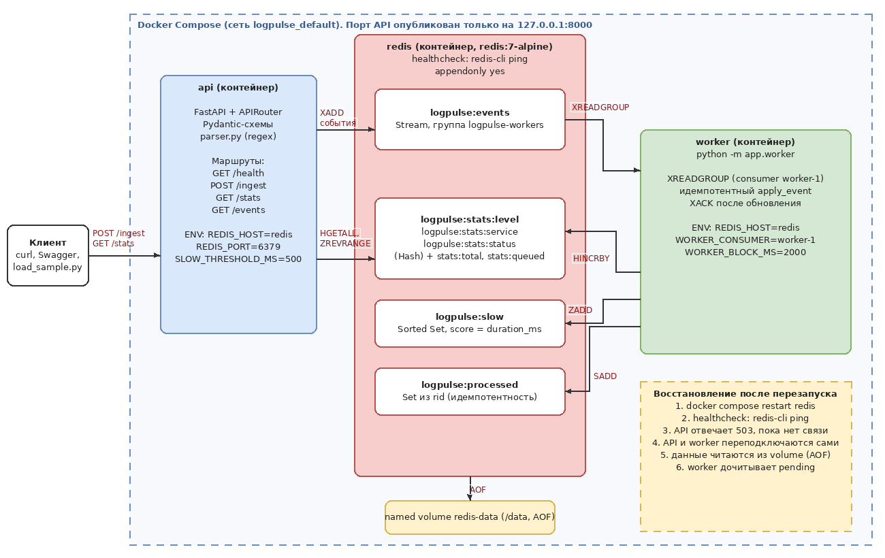

# LogPulse

Небольшая система для приёма и анализа логов сервисов `auth`, `orders` и `payment`.
HTTP API на FastAPI принимает строки журнала, проверяет их регулярными выражениями
и кладёт корректные события в Redis Stream. Отдельный worker читает поток через
consumer group, считает статистику и складывает её обратно в Redis. Всё запускается
одной командой `docker compose up`.

## Архитектура



Редактируемый оригинал схемы: [docs/architecture.drawio](docs/architecture.drawio)
(открывается на https://app.diagrams.net/).

Путь события: клиент → `POST /ingest` → проверка в `parser.py` → `XADD` в
`logpulse:events` → worker (`XREADGROUP`) → обновление хэшей и sorted set →
`XACK`. Статистика для `GET /stats` читается напрямую из Redis, в памяти API
ничего не хранится.

## Состав

| Компонент | Где | Назначение |
| --- | --- | --- |
| `api` | `app/main.py`, `app/routers/` | FastAPI, маршруты `/health`, `/ingest`, `/stats`, `/events` |
| `worker` | `app/worker.py` | чтение Stream, обновление статистики, XACK |
| `redis` | образ `redis:7-alpine` | очередь и статистика, данные в volume `redis-data` |
| парсер | `app/parser.py` | основная regex-маска, проверка полей, маскирование секретов |
| хранилище | `app/store.py` | ключи Redis и операции над ними |
| схемы | `app/schemas.py` | Pydantic-модели запросов и ответов |
| ошибки | `app/errors.py` | единый формат ошибок |

## Структуры Redis

| Ключ | Тип | Назначение |
| --- | --- | --- |
| `logpulse:events` | Stream | очередь событий, группа `logpulse-workers` |
| `logpulse:stats:level` | Hash | число событий по уровням |
| `logpulse:stats:service` | Hash | число событий по сервисам |
| `logpulse:stats:status` | Hash | число ответов по HTTP-кодам |
| `logpulse:slow` | Sorted Set | медленные запросы, score = `duration_ms`, member = `rid` |
| `logpulse:stats:queued` | String | сколько событий принято в очередь |
| `logpulse:stats:total` | String | сколько событий обработано worker |
| `logpulse:processed` | Set | `rid` уже учтённых событий (защита от дублей) |

Запрос считается медленным при `duration_ms >= 500`. В sorted set хранится
не больше 100 самых медленных.

## Запуск

Нужны Docker и Docker Compose.

```bash
cp .env.example .env
docker compose up --build -d
docker compose ps
```

Загрузка тестового журнала (60 строк, из них 8 с ошибками):

```bash
docker compose exec api python scripts/load_sample.py
```

Swagger UI: http://127.0.0.1:8000/docs, схема OpenAPI: http://127.0.0.1:8000/openapi.json.

Порт API опубликован только на `127.0.0.1`. Порт Redis наружу не открывается;
внутри сети compose он доступен по имени `redis`.

Остановить: `docker compose down` (данные в volume сохраняются).
Команда `docker compose down -v` удалит volume вместе с данными.

## Тесты

```bash
docker compose exec api pytest -q
```

Без Docker:

```bash
python -m venv .venv
source .venv/bin/activate        # Windows: .venv\Scripts\activate
pip install -r requirements.txt
pytest -q
```

Тесты используют `fakeredis` (Redis в памяти) и `TestClient` с подменой
зависимости `get_redis`, поэтому рабочие данные в Redis не затрагиваются.

## Примеры запросов

Приём пакета (3 корректные строки и 2 с ошибками):

```bash
curl -s -X POST http://127.0.0.1:8000/ingest \
  -H "Content-Type: application/json" \
  -d '{"lines": [
    "2026-10-20T12:34:56Z INFO auth 192.0.2.10 POST /api/login 200 43ms rid=ab12cd34",
    "2026-13-20T12:34:57Z INFO auth 192.0.2.10 POST /api/login 200 43ms rid=ab12cd35",
    "2026-10-20T12:34:58Z ERROR orders 198.51.100.8 GET /api/orders 503 742ms rid=ee44cc22",
    "2026-10-20T12:34:59Z INFO auth 192.0.2.300 GET /api/profile 200 18ms rid=ab12cd36",
    "2026-10-20T12:35:01Z WARN payment 203.0.113.7 POST /api/pay 429 301ms rid=ff44aa33"
  ]}'
```

Ответ:

```json
{
  "accepted": 3,
  "rejected": 2,
  "errors": [
    {"line_number": 2, "code": "bad_timestamp", "reason": "некорректная дата или время: 2026-13-20T12:34:57Z", "line": "..."},
    {"line_number": 4, "code": "bad_ip", "reason": "некорректный IPv4-адрес: 192.0.2.300", "line": "..."}
  ]
}
```

Остальные маршруты:

```bash
curl -s http://127.0.0.1:8000/health
curl -s http://127.0.0.1:8000/stats
curl -s "http://127.0.0.1:8000/events?limit=5"
```

Работа с Redis напрямую:

```bash
docker compose exec redis redis-cli XINFO STREAM logpulse:events
docker compose exec redis redis-cli XLEN logpulse:events
docker compose exec redis redis-cli HGETALL logpulse:stats:level
docker compose exec redis redis-cli ZREVRANGE logpulse:slow 0 4 WITHSCORES
```

## Pydantic-модели

| Модель | Поля |
| --- | --- |
| `IngestRequest` | `lines`: список строк, 1–100 элементов, длина каждой 1–500 символов |
| `IngestResponse` | `accepted`, `rejected`, `errors` |
| `IngestError` | `line_number`, `code`, `reason`, `line` |
| `StatsResponse` | `queued_total`, `processed_total`, `backlog`, `by_level`, `by_service`, `by_status`, `top_slow`, `slow_threshold_ms` |
| `SlowRequest` | `rid`, `duration_ms` |
| `EventsResponse`, `EventOut` | `count`, список событий с полями исходной строки и `id` записи Stream |
| `HealthResponse` | `status`, `api`, `redis`, при сбое ещё `error` |
| `ErrorResponse` | `error.code`, `error.message`, `error.details` |

## Коды ответов и ошибки

| Код | Когда |
| --- | --- |
| 200 | запрос выполнен |
| 422 | неверная структура запроса (нет `lines`, не список, 0 или больше 100 строк, строка длиннее 500 символов, `limit` вне 1–50) |
| 503 | нет связи с Redis |
| 500 | непредвиденная ошибка, подробности только в логе сервера |

Все ошибки возвращаются в одном формате:

```json
{"error": {"code": "redis_unavailable", "message": "Redis временно недоступен, повторите запрос позже"}}
```

## Известные ограничения

- Redis работает в одном экземпляре, без репликации.
- Worker запускается один. Несколько worker'ов с разными `WORKER_CONSUMER`
  работать будут, но при падении consumer'а его неподтверждённые сообщения
  дочитает только consumer с тем же именем (автоперехват через `XAUTOCLAIM` не реализован).
- Доставка «минимум один раз». Повторная доставка не искажает статистику,
  так как `rid` проверяется по множеству `logpulse:processed` в одной транзакции
  с обновлением счётчиков. Но этот набор растёт вместе с числом событий и
  никогда не очищается.
- Одинаковый `rid` в двух разных строках считается одним событием: вторая запись
  в статистику не попадёт.
- Поток обрезается примерно до 100000 записей (`STREAM_MAXLEN`).
- Redis без пароля, рассчитан на изолированную сеть compose.
- Счётчики `queued` и `total` считают события, а не строки: некорректные строки
  в них не входят.
